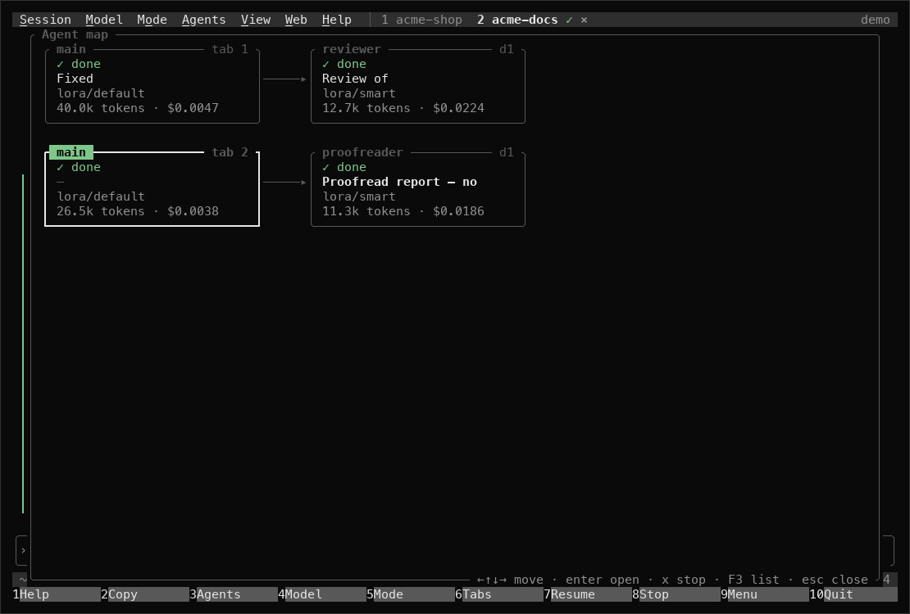
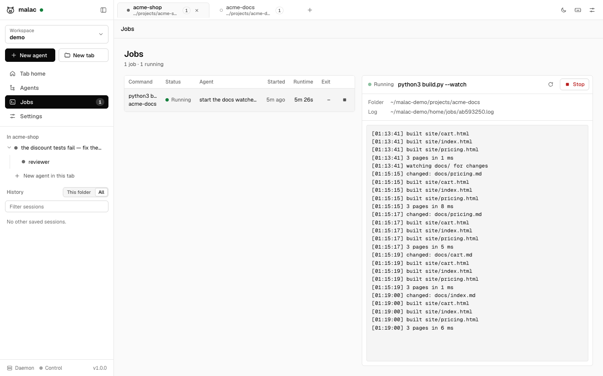

# malac

[](https://github.com/lobirus/malac/actions/workflows/ci.yml)
[](https://github.com/lobirus/malac/releases)
[](LICENSE)
[](https://www.rust-lang.org)

**Multi-Agent Loop for Autonomous Coding.** An autonomous coding agent for the terminal, with a web UI, a VS Code extension, and a control service for the desktop and browser. Written in Rust. (*Malac* is also Hungarian for pig.)


- **CLI first.** `malac <prompt>` starts working immediately. `malac` alone opens an interactive session.
- **Workspaces that outlive the terminal.** A per-user daemon holds your workspaces: sets of tabs, one per project, each with its own agents. Close the terminal and the agents keep working; open the web UI or another terminal and pick up where they are.
- **Any provider.** OpenAI-compatible and Anthropic-compatible APIs, several providers at once, per-model settings, profiles. Works with gateways such as LiteLLM, OpenRouter or Together, and with local models through Ollama or vLLM.
- **Autopilot.** `-y` runs without asking for permission. Deny rules still apply.
- **Subagents.** The agent delegates self-contained work to subagents that run in parallel, and you can watch each one live in the terminal, the web UI or the session log.
- **Memory.** Markdown memory files, optionally indexed in Milvus (self-hosted or remote) for semantic recall.
- **Computer and browser control.** `malac-control` is a separate MCP service for screenshots, mouse and keyboard, and Chrome automation with isolated profiles. malac starts it automatically.
- **MCP.** Connect any MCP server over stdio, streamable HTTP or WebSocket.

## Why malac

malac is opinionated. It is built around the way its author works, and it changes whenever that workflow does, to make everyday work faster and more comfortable. Defaults, keybindings and features follow from that, not from a roadmap or a committee.

It is open source so anyone can use it without wondering what runs under the hood: every prompt, tool and network call is in this repository. It is shared as is, not run as a community project. Issues and ideas are welcome, but pull requests may not be merged if they pull it in a different direction.

The name: *malac* is Hungarian for pig, which explains the mascot, and it is quick to type: five letters, three of them on the home row.

## Screenshots

| Terminal UI | Web UI |
|---|---|
|  |  |
|  |  |
|  |  |
|  |  |

<details>
<summary>Web UI in dark mode</summary>


</details>

## Install

Release builds (a macOS `.pkg` installer and `.tar.gz` archives for macOS and Linux) are published on [GitHub releases](https://github.com/lobirus/malac/releases). The install script uses the latest release when there is one for your machine, and otherwise builds from source (it needs Rust 1.86 or newer from [rustup.rs](https://rustup.rs) or `brew install rust`) and puts `malac` and `malac-control` in `~/.local/bin`:

```bash
curl -fsSL https://raw.githubusercontent.com/lobirus/malac/main/install.sh | sh
```

Set `MALAC_INSTALL_DIR` to install elsewhere, `MALAC_VERSION` to pick a release, `MALAC_FROM_SOURCE=1` to always build, `MALAC_REF` to build a branch or tag, or `MALAC_SOURCE=.` to build the checkout you are in. See [docs/releasing.md](docs/releasing.md) for making a release.

With Homebrew:

```bash
brew tap lobirus/malac https://github.com/lobirus/malac
brew install lobirus/malac/malac
```

From a checkout: `cargo install --path crates/malac && cargo install --path crates/malac-control`.

macOS is the primary platform and Linux is supported. Windows is untested.

## Quick start

Add a provider. The key is stored in `~/.malac/credentials.toml` with owner-only permissions:

```bash
printf '%s' "$OPENAI_API_KEY" | malac provider add openai \
  --base-url https://api.openai.com/v1 --model gpt-5 --api-key-stdin --set-default
```

`ANTHROPIC_API_KEY` or `OPENAI_API_KEY` in the environment also work with no setup.

```bash
malac explain how requests are routed in this repo
malac -y add a --json flag to the export command and test it
git diff | malac review this change
malac                        # interactive
malac -c                     # continue the last session in this directory
malac web --open             # the daemon's web UI
malac --plain -n             # a fresh workspace, served by the daemon
malac daemon status          # what the daemon is doing
```

If a prompt starts with a subcommand name, malac still treats it as a prompt when it does not parse as that subcommand: `malac web scraper for the docs` is a prompt. `malac -- <prompt>` always is.

## Terminal UI

`malac` opens a full-screen terminal UI in the spirit of Midnight Commander and byobu. It works with the keyboard alone, and everything is also clickable.

- **Header:** a menu bar (Session, Model, Mode, Agents, View, Connection, Help; F9 opens it), the workspace's tabs, one per project folder, and the workspace's name (with the daemon's, `server › work`, when it runs elsewhere).
- **Transcript:** streaming Markdown, tool calls as cards that expand on click or Enter, edits as diffs, and subagents as live cards you can open. A tab with several agents shows a switcher above it; F3 shows every agent as a list or a map.
- **Footer:** a status line (the daemon when it is another machine's, model, mode, context, tokens and cost, running agents, pending approvals, web UI, keep-awake, git branch, update, clock) above a function-key bar.
- **Dialogs:** permission requests (Allow / Always / Deny), a model picker across all providers, sessions, and help.

| Key | | Key | |
|---|---|---|---|
| F1 | Help | Ctrl-T / Ctrl-W | New tab here / close tab |
| F2, Ctrl-Y | Copy last answer | Alt-←/→, Alt-1…9 | Switch tab |
| F3 | Agents view | Enter / Alt-Enter | Send / new line |
| F4, Ctrl-P | Model picker | Esc, F8 | Stop the running turn |
| F5, Shift-Tab | Cycle mode | Ctrl-G | Toggle sidebar |
| F9, Ctrl-O | Menu bar | Ctrl-S | Mouse off, for selecting text |
| F10 | Quit (agents keep running) | Right-click | Context menu |
| Alt-↑/↓, Ctrl-N | Switch agent / new agent in the tab | Drag, double-click | Select and copy text |
| @, Ctrl-V | Attach a file / a clipboard image | Ctrl-R | Reconnect to the daemon |

Both it and `--plain` (or `ui.tui = false`, a line-based interface) are clients of the daemon (see below). `-p`, `--json` and piped input always print plainly and run in-process. Inside tmux or byobu, clicks need `set -g mouse on`. On macOS, set the Option key to send Meta for the Alt shortcuts.

## Workspaces and tabs

A workspace is a set of tabs, and a tab is a project: a directory with its own configuration, instructions and agents. A tab can hold several top-level agents side by side, each with its subagents. Workspaces live in the daemon and are saved in `~/.malac/workspaces/`, so they survive restarts and reboots; agents come back idle and resume from their transcripts when you prompt them.

```bash
malac --plain                         # resume the last workspace, all its tabs
malac --plain fix the flaky test      # a new tab for this directory in it, running the prompt
malac --plain --name api add paging   # the same, with the tab named "api"
malac --plain -n                      # a fresh workspace; the old one stays resumable
malac --plain -n --name release       # ... named "release"
malac --plain -w release              # open a workspace by name or id
malac --plain -c                      # attach the last session of this directory in a tab
malac workspaces                      # list; rename <ws> <name>; delete <ws>
```

The terminal UI, the web UI and the editor extension share the daemon's workspaces: `malac` reopens the last workspace where you left it, `-n` starts a clean one, `-w` opens one, `--name` names the tab (or, with `-n`, the workspace), and `malac "<prompt>"` adds a tab for the prompt. Several terminals can work on one workspace at once, and agents keep running when they close.

## The daemon

`malac daemon` is one background process per user that holds every workspace, tab, agent and job. Interactive clients start it when it is not running and connect through `~/.malac/daemon.json`; it serves the web UI and an HTTP and WebSocket API ([docs/protocol.md](docs/protocol.md)).

| Command | |
|---|---|
| `malac daemon start` | Start it in the background (the default); output goes to `~/.malac/daemon.log` |
| `malac daemon run` | Run it in the foreground |
| `malac daemon status [--json]` | Version, URL, clients, workspaces, running agents and jobs |
| `malac daemon stop [--force]` | Stop it; refused while agents or jobs run unless `--force` |
| `malac daemon restart [--force]` | Stop and start, e.g. to use an updated malac |

Permission prompts go to every connected client, and the first answer wins; a client that connects later still sees what is waiting. Background jobs (`bash` with `background: true`) are listed with their output, and stopped with `job_kill` or from a client. While agents or jobs run, the daemon keeps the machine from sleeping (`daemon.keep_awake`). The daemon exits after `daemon.idle_minutes` (default 120) with no clients and nothing running. Updating malac never disturbs it: it keeps its version until restarted, and clients show a notice when theirs differs.

## Command line

| Flag | |
|---|---|
| `-m, --model provider/model` | Model for this session |
| `-y, --autopilot` | Never ask for permission |
| `--mode ask\|edits\|autopilot` | Permission mode |
| `-p, --print` | Answer the prompt and exit |
| `--json` | Stream events as JSON lines |
| `-c, --continue` / `-r, --resume <id>` | Continue a session |
| `-n, --new` | Start a fresh workspace (daemon clients) |
| `-w, --workspace <name\|id>` | Open a workspace (daemon clients) |
| `--name <name>` | Name the new tab, or with `-n` the new workspace |
| `--profile <name>` | Apply `[profiles.<name>]` from the config |
| `--no-control` | Do not connect the control service |
| `-v, --verbose` | Show model reasoning |
| `--plain` | Line-based interface instead of the full-screen UI |
| `-C, --connect <name>` | Use a saved connection's daemon on another machine ([Remote access](#remote-access)) |

The daemon serves the web UI for every session, so no flag is needed for it: `malac web` prints its address. Other machines connect after pairing; see [Remote access](#remote-access).

| Subcommand | |
|---|---|
| `malac web` | Make sure the daemon runs and print its web UI URL (`--open`, `--json-ready`, `--cwd`, `--port`, `--remote`) |
| `malac daemon [run\|start\|stop\|status\|restart]` | The background daemon |
| `malac workspaces [list\|rename\|delete]` | Saved workspaces |
| `malac models` | Every model your providers offer |
| `malac update [--check]` | Update to the latest release |
| `malac sessions [list\|show <id>\|delete <id>]` | Saved transcripts, including subagents |
| `malac provider add\|list\|models` | Providers and keys |
| `malac config [path\|show]` | Configuration files and the merged result |
| `malac memory [list\|search\|reindex]` | Long-term memory |
| `malac mcp` | Connected MCP servers and their tools |
| `malac plugin ...` | Plugins and marketplaces: `marketplace add\|list\|update\|remove`, `install`, `enable`, `disable`, `uninstall`, `update`, `list`, `show` |
| `malac index [--rebuild]` | Build or update the project index, `.malac/index.md` |
| `malac context [--json]` | What a session here reads: instruction files, docs, index, skills, commands, plugins |
| `malac remote [status\|pair\|devices\|revoke\|add\|list\|remove]` | Pair devices with this daemon and save connections to daemons elsewhere |
| `malac tunnel [cloudflare\|ngrok\|tailscale\|tailscale-funnel\|status\|stop]` | Give the daemon a public address |
| `malac control ...` | Run `malac-control` |

In a session: `/model`, `/mode`, `/agents`, `/compact`, `/clear`, `/resume`, `/cost`, `/mcp`, `/memory`, `/web`, `/context`, `/exit`, plus your commands, skills and plugin commands (`/ponytail-review`, `/release-tools:release-notes 2.0`). Ctrl-C interrupts the current turn and every subagent it started.

## Permissions

| Mode | Edits | Commands, web, browser |
|---|---|---|
| `ask` (default) | ask | ask |
| `edits` | allowed | ask |
| `autopilot` | allowed | allowed |

Reading, searching, memory and delegation never ask. Rules refine the defaults:

```toml
[permissions]
allow = ["bash(cargo *)", "bash(git status*)", "browser_*"]
deny = ["bash(rm -rf /*)", "bash(git push --force*)"]
```

Deny rules are enforced in every mode. Shell commands are checked segment by segment, so `cargo build && curl ...` does not match `bash(cargo *)`. Answering a prompt with "always" allows that program, or that tool, for the rest of the session.

## Subagents

The agent has four delegation tools: `agent_spawn`, `agent_wait`, `agent_send` and `agent_list`. Several `agent_spawn` calls in one response run in parallel, up to `agents.max_concurrent`. A subagent gets a fresh context, the same tools (or read-only ones), and reports back when it is done.

You can follow subagents in three places:

- **Terminal:** one indented line per step (`↳ tests · bash cargo test`), then `✓ tests finished`. `/agents` shows the tree and what each agent is doing.
- **Web UI:** the agent tree in the sidebar, with each subagent's full live transcript one click away.
- **Logs:** `malac sessions show <id>` prints a session and all of its subagents.

Reusable agent types are Markdown files in `.malac/agents/`; see [configuration](docs/configuration.md#agents).

## Memory

The agent saves durable facts with `memory_save`: user preferences, project commands, conventions, gotchas, decisions. Each memory is a Markdown file in `~/.malac/memory/` (global) or `.malac/memory/` (project), and an index of them is part of every prompt. Project memories are listed by kind in `.malac/MALAC.md` (see [Project context](#project-context)); commit both, and the knowledge reaches your other machines and your teammates.

Add a Milvus collection for semantic search and automatic recall:

```toml
[memory.vector]
url = "http://localhost:19530"        # or https://<cluster>.zillizcloud.com
token_env = "MILVUS_TOKEN"

[memory.embeddings]
provider = "openai"
model = "text-embedding-3-small"
```

The files stay the source of truth. `malac memory reindex` rebuilds the collection from them.

## Project context

Before the first prompt, malac reads what the project says about itself:

- **Instruction files**, from `~/.malac/` and every directory between the repository root and where you are: `AGENTS.md` first, then `MALAC.md`, `CLAUDE.md`, `GEMINI.md`, `.github/copilot-instructions.md`, `.cursorrules`, `.cursor/rules/*.mdc`, `.windsurfrules`, `.clinerules` and the rest of the forms other agents use, plus `~/.claude/CLAUDE.md` and anything in `[context] instruction_files`. A `CLAUDE.md` that is a symlink to (or a copy of) `AGENTS.md` is read once. Cursor rules with `globs` are listed for the files they cover rather than pasted.
- **A docs map**: README, ARCHITECTURE, CONTRIBUTING, `docs/**` and decision records, each as a path, its title and one line, so the agent knows where to look without reading them all.
- **The project index**, `.malac/index.md`: the directory tree with file counts, languages, manifests and entry points, the top-level symbols of every source file and the headings of the docs. It is built without a model, follows `.gitignore`, rereads only changed files and refreshes itself in the background; the agent reads it with `project_index` before searching broadly, and leaves notes in it for the next session. It is regenerable, so `.malac/.gitignore` keeps it out of git; `malac index` updates it by hand.
- **Project knowledge**, `.malac/MALAC.md`: what malac learned here, kept as project memories and listed by kind (commands, conventions, gotchas, decisions). It is meant to be committed. Instructions for agents stay in `AGENTS.md`, which malac suggests changes to but does not write unasked.

Working in `frontend/` of a repository that also has `backend/`? The agent is told where the other parts are, and the UIs suggest opening the repository root, which is what to do for work across the stack. `/context` (or `malac context`) shows everything that was loaded and why anything was skipped. See [configuration](docs/configuration.md#context).

## Skills

Skills follow the [Agent Skills](https://agentskills.io/specification) format: a folder with a `SKILL.md` (name and description, then instructions), optionally with `scripts/` and `references/`. malac finds them in `~/.malac/skills/`, `.malac/skills/`, `.claude/skills/`, `~/.claude/skills/`, `.agents/skills/` and in plugins. The prompt lists each one's name and description; the agent loads a skill with the `skill` tool when it fits, and runs its scripts with `bash`, where `$SKILL_DIR` points at the skill. Every skill is also a slash command: `/release 2.0`.

## Plugins and marketplaces

Plugins bundle skills, slash commands, agent types, MCP servers and hooks. malac installs both Claude Code plugins and [Agent Plugins](https://agent-plugins.org), from marketplaces: folders, GitHub (`owner/repo`), GitLab or any git URL, private repositories included through your own git credentials, or the URL of a `marketplace.json`.

```bash
malac plugin marketplace add lobirus/agent-plugins
malac plugin install server-setup@lobirus
malac plugin marketplace add git@gitlab.example.com:team/agent-plugins.git --project   # for the whole team
```

[lobirus/agent-plugins](https://github.com/lobirus/agent-plugins) is the recommended marketplace to start with: every plugin in it is both an Agent Plugins package and a Claude Code plugin, so the same marketplace works in malac, Claude Code, Codex, Copilot, VS Code and Cursor.

Installing runs nothing. A plugin with hooks, MCP servers or scripts is enabled only after you approve what it runs, and a repository's `.malac/plugins.toml` can list plugins for the team but never turns their code on by itself. Hooks cover session start, prompts and tool calls (allow, deny, ask, or change the input). malac ships [ponytail](https://ponytail.dev) (MIT, by Dietrich Gebert) as a default plugin for lean, complete changes and reviews; `malac plugin disable ponytail@malac` or `[plugins] defaults = false` turns it off. See [docs/plugins.md](docs/plugins.md) for the formats, sources, scopes, security model and how to publish a marketplace that every agent can read, and [examples/marketplace](examples/marketplace) for one.

## Computer and browser control

`malac-control` exposes the desktop and Chrome as MCP tools. malac spawns it automatically when it is installed. You can also run it as a long-lived service that other agents can use:

```bash
malac-control serve --port 7878   # writes ~/.malac/control.json; malac connects to it
malac-control profiles            # list browser profiles
malac-control permissions         # macOS Screen Recording and Accessibility, and who holds them
malac-control permissions --request   # ask for the missing ones and open System Settings
```

Each browser profile is a separate Chrome instance with its own data directory, so logins persist and never mix. You can also attach to a browser you already started with remote debugging. Profiles go in `~/.malac/control.toml`:

```toml
[browser.profiles.work]
[browser.profiles.personal]
clone_from = "Profile 1"           # copy an existing Chrome profile on first launch
[browser.profiles.debug]
cdp_url = "http://127.0.0.1:9222"
```

On macOS, desktop control needs Screen Recording and Accessibility. macOS grants them to the app that started the process tree: the terminal you started the daemon from, or your editor if its extension started it. Grant both to that app, then restart it and the daemon (`malac daemon restart`). To make it independent of who starts the daemon, run `malac-control serve` in a terminal that has the permissions; the daemon connects to it. The daemon's snapshot and the `computer_permissions` tool report the current state.

## Web UI and VS Code

`malac web` starts the daemon if needed and prints its UI address, `127.0.0.1:7700` by default, with a token that is part of the URL (kept in `~/.malac/daemon.token`; delete it to get a new one). The UI shows live sessions, the subagent tree, streaming transcripts, tool calls and approval prompts, and every setting can be changed from it.

The web UI is local-only by default; other machines and phones use it after pairing (see [Remote access](#remote-access)). The daemon always serves the UI, so terminal sessions need no flag for it; `malac web` prints its address.

The extension in [`editors/vscode`](editors/vscode) puts malac in the activity bar (the pig), next to GitHub Copilot and Claude Code:

- **Chat**: a native panel with streaming answers, tool cards and Allow / Always / Deny approvals inline, a model picker, the permission mode (Shift+Tab cycles it) and Stop. The open file goes along as a chip (`README.md`, or `README.md:12-30` with a selection) that you can turn off; `@` picks workspace files; drop files from the Explorer (hold Shift) or Finder, and drop or paste screenshots.
- **Workspaces → Tabs → Agents**, **Jobs** (log tail, kill) and **Sessions** trees, and a **Usage** view with tokens and cost today, over the week and per model.
- A status bar item with running agents and waiting approvals, approval notifications when the chat is hidden, and commands: Ask About Selection, Add File to Context, New Agent, New Tab for This Folder, Stop Agent, Open Full UI (the web UI in a panel), Restart Daemon.

It connects to the daemon in `~/.malac/daemon.json`, or starts one with `malac web`, and offers a tab for the workspace folder (the repository root when the folder sits inside a larger repository). See [editors/vscode/README.md](editors/vscode/README.md). Download `malac-vscode-<version>.vsix` from the [latest release](https://github.com/lobirus/malac/releases/latest) and install it with `code --install-extension malac-vscode-<version>.vsix`, or via Extensions → … → Install from VSIX. The same file works in VS Code–compatible editors such as Cursor, Windsurf and VSCodium. It is not on the Marketplace yet. To work on it, open `editors/vscode` in VS Code and press F5, or:

```bash
cd editors/vscode && npm install && npm test && code --extensionDevelopmentPath="$PWD" /path/to/project
```

Set `malac.path` if `malac` is not on your `PATH` (the extension also looks in `~/.local/bin`, `~/.cargo/bin` and Homebrew).

## Remote access

Run the agents on a server and command them from your laptop or phone. Remote access is opt-in: `web.remote = true` or `malac daemon start --remote`. The master token never leaves the daemon's machine; every other device pairs once for a token of its own, which you can revoke.

```bash
# on the server
malac daemon start --remote
malac remote pair                     # a code valid for ten minutes, and a QR code for a phone

# on the laptop
malac remote add server http://192.168.1.20:7700 --pair ABCDE-FGHJK
malac -C server                       # the full-screen UI on the server's daemon (also --plain, -p, prompts)
```

| Way | |
|---|---|
| Same network | `--remote`, then the server's address |
| SSH tunnel | `ssh -N -L 7700:127.0.0.1:7700 server`, then `http://127.0.0.1:7700`; works with remote access off |
| Cloudflare Tunnel, ngrok, Tailscale | `malac tunnel cloudflare`, `ngrok`, `tailscale` or `tailscale-funnel`: the daemon runs the tool, prints the public address and stops it when it stops (`[remote] tunnel` starts one with it) |

In the terminal UI, the **Connection** menu switches between this computer and saved daemons (remembered for the next `malac`), and Connection → Remote access shows whether others may connect, the addresses, the paired devices, keep-awake, how to connect and a pairing QR code. The web UI has the same under Settings → Remote access, and a browser opened at a daemon's address shows a pairing form. `malac remote devices` and `malac remote revoke <id>` manage devices.

While agents or jobs run, the daemon keeps the machine awake (`caffeinate` on macOS, `systemd-inhibit` on Linux), and releases it a minute after; `daemon.keep_awake = "always"` or `"off"` changes that. A MacBook still sleeps when its lid closes, unless it is in clamshell mode.

See [docs/remote.md](docs/remote.md) for pairing, devices, tunnels, the security model, keep-awake and what apps need.

## Updating

`malac update` installs the latest release. Running sessions and subagents keep the version they started with, so updating is safe at any time. malac checks for new releases once a day and shows when one is available, in the terminal and in the web UI. Set `update.auto = true` to install them automatically.

## Configuration

Ask malac: "switch to lora/smart", "add OpenRouter as a provider with my key", "allow cargo commands without asking". It changes its own configuration with the `malac_configure` tool, asking for approval first.

`~/.malac/config.toml` for you, `.malac/config.toml` for a project, `AGENTS.md` (or any of the other instruction files) for instructions, `.malac/plugins.toml` for the project's plugins. See [docs/configuration.md](docs/configuration.md) and [examples/config.toml](examples/config.toml).

## Things to know

- **Early software.** malac is at 0.1. macOS is the primary platform, Linux works, and Windows is untested. Expect rough edges and breaking config changes before 1.0.
- **Autopilot means autopilot.** With `-y` the agent runs commands and edits files without asking. Deny rules still apply, but they are pattern matches, not a sandbox. Use it in repositories you can restore.
- **Project config is restricted.** A repository's `.malac/config.toml` cannot set the mode, providers, MCP servers, control service, permissions, memory, web UI, update settings or profiles unless you set `trust_project_config = true`. Cloning a repository is never enough to make malac run its commands.
- **Plugins are code.** Hooks and MCP servers from plugins run on your machine with your permissions once you approve them. Read what `malac plugin show` lists before approving, as you would before running a script from the internet.
- **Your data stays local.** Transcripts are JSONL files in `~/.malac/sessions` and memories are Markdown files, both readable and deletable. Anything you paste into a prompt, including an API key, ends up in that session's transcript. Prefer `api_key_env` or `malac provider add --api-key-stdin`, which writes `~/.malac/credentials.toml` with owner-only permissions.
- **Desktop control needs macOS permissions.** macOS grants Screen Recording and Accessibility to the app that started `malac-control`, usually your terminal. Grant both to the terminal you use, or run `malac-control serve` in one that has them; malac connects to it automatically.
- **Browsers run in their own profiles.** Each malac browser profile is a separate Chrome data directory under `~/.malac/browser`. Chrome does not allow remote control of your everyday profile, so log in once inside the malac profile, or use `clone_from` to copy an existing profile.
- **The web UI is local unless you say otherwise.** Its token works only on the daemon's machine. With remote access on, paired devices connect over plain HTTP unless a tunnel or proxy adds TLS; use an SSH tunnel, Tailscale or a TLS proxy outside trusted networks. A paired device can do everything you can, so revoke lost ones.
- **Updating is safe while agents run.** Binaries are replaced with an atomic rename. Running sessions and the daemon keep their version until you restart them (`malac daemon restart`).
- **The daemon keeps running.** Agents started through it continue after the terminal closes, until they finish; the daemon itself exits after two idle hours. It keeps the environment it was started with, so restart it after changing API key variables.
- **Models without vision** get screenshots described by `vision_model` when you mark them `vision = false`.
- **Inside tmux or byobu**, mouse clicks reach the terminal UI only with `set -g mouse on`. Everything also works from the keyboard.

## Development

```bash
cargo test
cargo clippy --all-targets
cargo run -p malac -- --help
```

See [docs/architecture.md](docs/architecture.md) for how the pieces fit together.

## License

malac is created by [lobirus](https://github.com/lobirus) and released under the MIT license.
