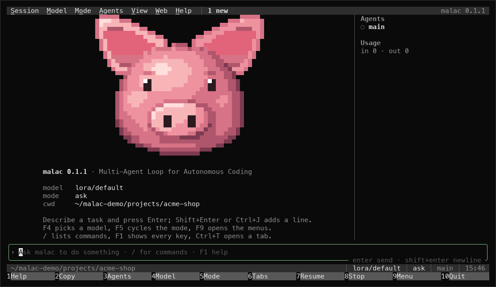
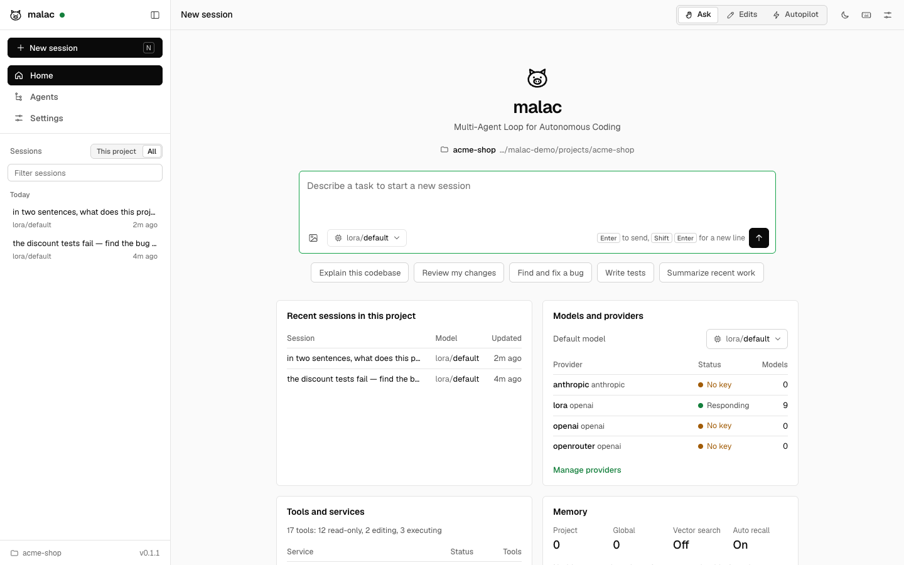
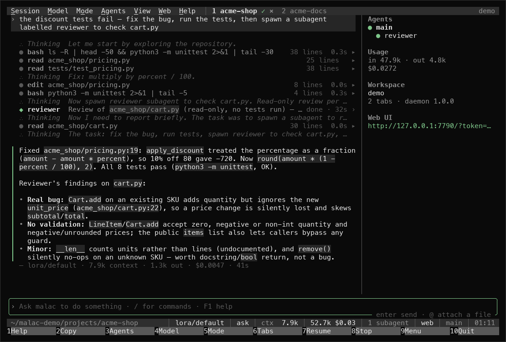
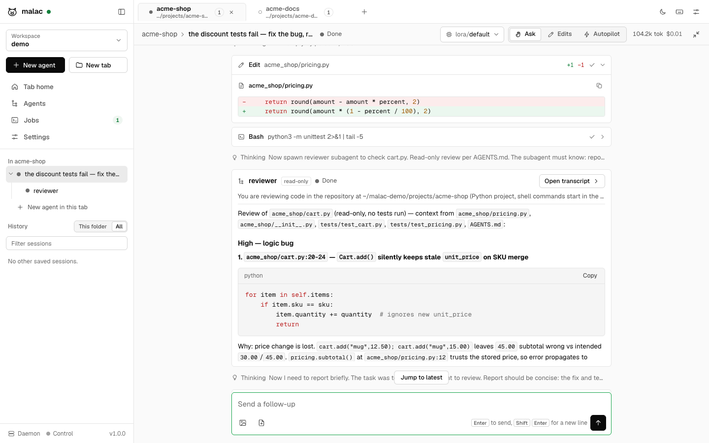
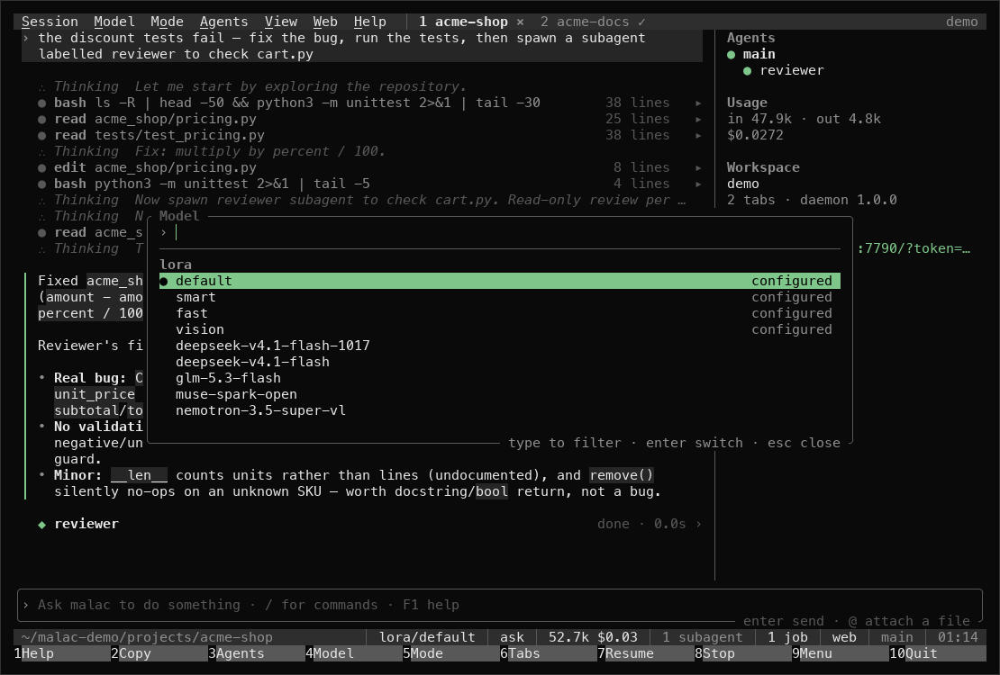
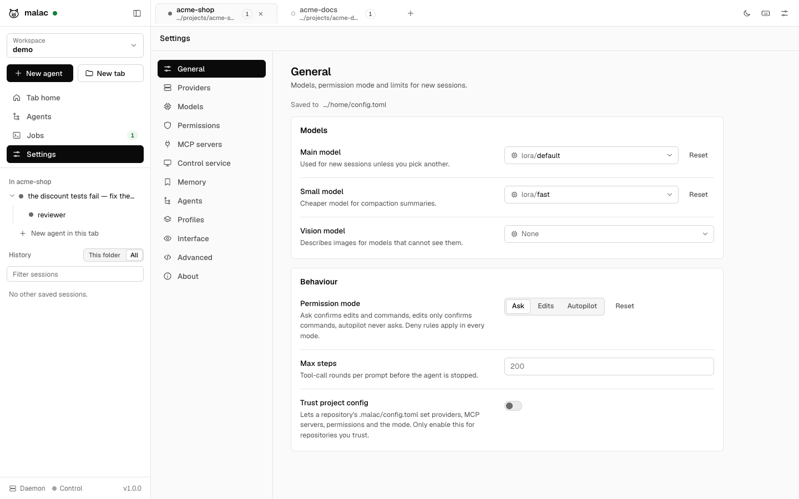
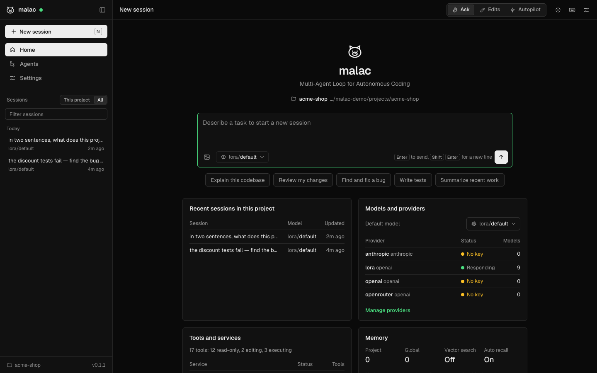

# malac

[](https://github.com/lobirus/malac/actions/workflows/ci.yml)
[](https://github.com/lobirus/malac/releases)
[](LICENSE)
[](https://www.rust-lang.org)

**Multi-Agent Loop for Autonomous Coding.** An autonomous coding agent for the terminal, with a web UI, a VS Code extension, and a control service for the desktop and browser. Written in Rust. (*Malac* is also Hungarian for pig.)



- **CLI first.** `malac <prompt>` starts working immediately. `malac` alone opens an interactive session.
- **Any provider.** OpenAI-compatible and Anthropic-compatible APIs, several providers at once, per-model settings, profiles. Works with gateways such as LiteLLM, OpenRouter or Together, and with local models through Ollama or vLLM.
- **Autopilot.** `-y` runs without asking for permission. Deny rules still apply.
- **Subagents.** The agent delegates self-contained work to subagents that run in parallel, and you can watch each one live in the terminal, the web UI or the session log.
- **Memory.** Markdown memory files, optionally indexed in Milvus (self-hosted or remote) for semantic recall.
- **Computer and browser control.** `malac-control` is a separate MCP service for screenshots, mouse and keyboard, and Chrome automation with isolated profiles. malac starts it automatically.
- **MCP.** Connect any MCP server over stdio, streamable HTTP or WebSocket.

## Why malac

malac is opinionated. It is built around the way its author works, and it changes whenever that workflow does, to make everyday work faster and more comfortable. Defaults, keybindings and features follow from that, not from a roadmap or a committee.

It is open source so anyone can use it without wondering what runs under the hood: every prompt, tool and network call is in this repository. It is shared as is, not run as a community project. Issues and ideas are welcome, but pull requests may not be merged if they pull it in a different direction.

The name: *malac* is Hungarian for pig, which explains the mascot, and it is quick to type: five letters, three of them on the home row.

## Screenshots

| Terminal UI | Web UI |
|---|---|
|  |  |
|  |  |
|  |  |

<details>
<summary>Web UI in dark mode</summary>



</details>

## Install

Release builds (a macOS `.pkg` installer and `.tar.gz` archives for macOS and Linux) are published on [GitHub releases](https://github.com/lobirus/malac/releases). The install script uses the latest release when there is one for your machine, and otherwise builds from source (it needs Rust 1.86 or newer from [rustup.rs](https://rustup.rs) or `brew install rust`) and puts `malac` and `malac-control` in `~/.local/bin`:

```bash
curl -fsSL https://raw.githubusercontent.com/lobirus/malac/main/install.sh | sh
```

Set `MALAC_INSTALL_DIR` to install elsewhere, `MALAC_VERSION` to pick a release, `MALAC_FROM_SOURCE=1` to always build, `MALAC_REF` to build a branch or tag, or `MALAC_SOURCE=.` to build the checkout you are in. See [docs/releasing.md](docs/releasing.md) for making a release.

With Homebrew:

```bash
brew tap lobirus/malac https://github.com/lobirus/malac
brew install lobirus/malac/malac
```

From a checkout: `cargo install --path crates/malac && cargo install --path crates/malac-control`.

macOS is the primary platform and Linux is supported. Windows is untested.

## Quick start

Add a provider. The key is stored in `~/.malac/credentials.toml` with owner-only permissions:

```bash
printf '%s' "$OPENAI_API_KEY" | malac provider add openai \
  --base-url https://api.openai.com/v1 --model gpt-5 --api-key-stdin --set-default
```

`ANTHROPIC_API_KEY` or `OPENAI_API_KEY` in the environment also work with no setup.

```bash
malac explain how requests are routed in this repo
malac -y add a --json flag to the export command and test it
git diff | malac review this change
malac                        # interactive
malac -c                     # continue the last session in this directory
malac --web                  # interactive, with the web UI attached
malac web --open             # web UI only
```

If a prompt starts with a subcommand name, malac still treats it as a prompt when it does not parse as that subcommand: `malac web scraper for the docs` is a prompt. `malac -- <prompt>` always is.

## Terminal UI

`malac` opens a full-screen terminal UI in the spirit of Midnight Commander and byobu. It works with the keyboard alone, and everything is also clickable.

- **Header:** a menu bar (Session, Model, Mode, Agents, View, Web, Help; F9 opens it) and tabs, one per session.
- **Transcript:** streaming Markdown, tool calls as cards that expand on click or Enter, edits as diffs, and subagents as live cards you can open, or pin as their own tab.
- **Footer:** a status line (model, mode, context, tokens and cost, running agents, pending approvals, web UI, git branch, update, clock) above a function-key bar.
- **Dialogs:** permission requests (Allow / Always / Deny), a model picker across all providers, sessions, and help.

| Key | | Key | |
|---|---|---|---|
| F1 | Help | Ctrl-T / Ctrl-W | New / close tab |
| F2, Ctrl-Y | Copy last answer | Alt-←/→, Alt-1…9 | Switch tab |
| F3 | Agents view | Enter / Alt-Enter | Send / new line |
| F4, Ctrl-P | Model picker | Esc, F8 | Stop the running turn |
| F5, Shift-Tab | Cycle mode | Ctrl-G | Toggle sidebar |
| F9, Ctrl-O | Menu bar | Ctrl-S | Mouse off, for selecting text |
| F10 | Quit | Right-click | Context menu |

`--plain` (or `ui.tui = false`) uses a line-based interface instead. `-p`, `--json` and piped input always do. Inside tmux or byobu, clicks need `set -g mouse on`. On macOS, set the Option key to send Meta for the Alt shortcuts.

## Command line

| Flag | |
|---|---|
| `-m, --model provider/model` | Model for this session |
| `-y, --autopilot` | Never ask for permission |
| `--mode ask\|edits\|autopilot` | Permission mode |
| `-p, --print` | Answer the prompt and exit |
| `--json` | Stream events as JSON lines |
| `-c, --continue` / `-r, --resume <id>` | Continue a session |
| `--profile <name>` | Apply `[profiles.<name>]` from the config |
| `--web` / `--no-web` | Serve the web UI for this session too, or not (default: `web.enabled`) |
| `--web-remote` | Serve it to other machines as well (default: `web.remote`) |
| `--web-port <port>` | Web UI port (default: `web.port`, or any free port) |
| `--no-control` | Do not connect the control service |
| `-v, --verbose` | Show model reasoning |
| `--plain` | Line-based interface instead of the full-screen UI |

| Subcommand | |
|---|---|
| `malac web` | Web UI (`--port`, `--remote`, `--open`, `--json-ready`) |
| `malac models` | Every model your providers offer |
| `malac update [--check]` | Update to the latest release |
| `malac sessions [list\|show <id>\|delete <id>]` | Saved transcripts, including subagents |
| `malac provider add\|list\|models` | Providers and keys |
| `malac config [path\|show]` | Configuration files and the merged result |
| `malac memory [list\|search\|reindex]` | Long-term memory |
| `malac mcp` | Connected MCP servers and their tools |
| `malac control ...` | Run `malac-control` |

In a session: `/model`, `/mode`, `/agents`, `/compact`, `/clear`, `/resume`, `/cost`, `/mcp`, `/memory`, `/web`, `/exit`. Ctrl-C interrupts the current turn and every subagent it started.

## Permissions

| Mode | Edits | Commands, web, browser |
|---|---|---|
| `ask` (default) | ask | ask |
| `edits` | allowed | ask |
| `autopilot` | allowed | allowed |

Reading, searching, memory and delegation never ask. Rules refine the defaults:

```toml
[permissions]
allow = ["bash(cargo *)", "bash(git status*)", "browser_*"]
deny = ["bash(rm -rf /*)", "bash(git push --force*)"]
```

Deny rules are enforced in every mode. Shell commands are checked segment by segment, so `cargo build && curl ...` does not match `bash(cargo *)`. Answering a prompt with "always" allows that program, or that tool, for the rest of the session.

## Subagents

The agent has four delegation tools: `agent_spawn`, `agent_wait`, `agent_send` and `agent_list`. Several `agent_spawn` calls in one response run in parallel, up to `agents.max_concurrent`. A subagent gets a fresh context, the same tools (or read-only ones), and reports back when it is done.

You can follow subagents in three places:

- **Terminal:** one indented line per step (`↳ tests · bash cargo test`), then `✓ tests finished`. `/agents` shows the tree and what each agent is doing.
- **Web UI:** the agent tree in the sidebar, with each subagent's full live transcript one click away.
- **Logs:** `malac sessions show <id>` prints a session and all of its subagents.

Reusable agent types are Markdown files in `.malac/agents/`; see [configuration](docs/configuration.md#agents).

## Memory

The agent saves durable facts with `memory_save`: user preferences, project conventions, decisions. Each memory is a Markdown file in `~/.malac/memory/` (global) or `.malac/memory/` (project), and an index of them is part of every prompt.

Add a Milvus collection for semantic search and automatic recall:

```toml
[memory.vector]
url = "http://localhost:19530"        # or https://<cluster>.zillizcloud.com
token_env = "MILVUS_TOKEN"

[memory.embeddings]
provider = "openai"
model = "text-embedding-3-small"
```

The files stay the source of truth. `malac memory reindex` rebuilds the collection from them.

## Computer and browser control

`malac-control` exposes the desktop and Chrome as MCP tools. malac spawns it automatically when it is installed. You can also run it as a long-lived service that other agents can use:

```bash
malac-control serve --port 7878   # writes ~/.malac/control.json; malac connects to it
malac-control profiles            # list browser profiles
```

Each browser profile is a separate Chrome instance with its own data directory, so logins persist and never mix. You can also attach to a browser you already started with remote debugging. Profiles go in `~/.malac/control.toml`:

```toml
[browser.profiles.work]
[browser.profiles.personal]
clone_from = "Profile 1"           # copy an existing Chrome profile on first launch
[browser.profiles.debug]
cdp_url = "http://127.0.0.1:9222"
```

On macOS, grant Screen Recording and Accessibility permissions to the terminal app (or to `malac-control`) for desktop control.

## Web UI and VS Code

`malac web` serves the UI on `127.0.0.1:7700` and protects it with a random token that is part of the printed URL. The UI shows live sessions, the subagent tree, streaming transcripts, tool calls and approval prompts, and every setting can be changed from it.

The web UI is local-only by default. `malac web --remote` (or `web.remote = true`) listens on all interfaces and prints a LAN URL as well. The token is still required, but traffic is plain HTTP, so prefer an SSH tunnel or a reverse proxy with TLS on untrusted networks. `web.enabled = true` serves the UI alongside every interactive terminal session.

The extension in [`editors/vscode`](editors/vscode) embeds the same UI in a panel and adds **Malac: Ask About Selection** and **Malac: Run in Terminal**. Download `malac-vscode-<version>.vsix` from the [latest release](https://github.com/lobirus/malac/releases/latest) and install it with `code --install-extension malac-vscode-<version>.vsix`, or via Extensions → … → Install from VSIX. The same file works in VS Code–compatible editors such as Cursor, Windsurf and VSCodium. It is not on the Marketplace yet. To work on it, open `editors/vscode` in VS Code and press F5, or:

```bash
cd editors/vscode && npm install && npx tsc -p . && code --extensionDevelopmentPath="$PWD" /path/to/project
```

Set `malac.path` if `malac` is not on your `PATH`.

## Updating

`malac update` installs the latest release. Running sessions and subagents keep the version they started with, so updating is safe at any time. malac checks for new releases once a day and shows when one is available, in the terminal and in the web UI. Set `update.auto = true` to install them automatically.

## Configuration

Ask malac: "switch to lora/smart", "add OpenRouter as a provider with my key", "allow cargo commands without asking". It changes its own configuration with the `malac_configure` tool, asking for approval first.

`~/.malac/config.toml` for you, `.malac/config.toml` for a project, `AGENTS.md` (or `MALAC.md`, `CLAUDE.md`) for instructions. See [docs/configuration.md](docs/configuration.md) and [examples/config.toml](examples/config.toml).

## Things to know

- **Early software.** malac is at 0.1. macOS is the primary platform, Linux works, and Windows is untested. Expect rough edges and breaking config changes before 1.0.
- **Autopilot means autopilot.** With `-y` the agent runs commands and edits files without asking. Deny rules still apply, but they are pattern matches, not a sandbox. Use it in repositories you can restore.
- **Project config is restricted.** A repository's `.malac/config.toml` cannot set the mode, providers, MCP servers, control service, permissions, memory, web UI, update settings or profiles unless you set `trust_project_config = true`. Cloning a repository is never enough to make malac run its commands.
- **Your data stays local.** Transcripts are JSONL files in `~/.malac/sessions` and memories are Markdown files, both readable and deletable. Anything you paste into a prompt, including an API key, ends up in that session's transcript. Prefer `api_key_env` or `malac provider add --api-key-stdin`, which writes `~/.malac/credentials.toml` with owner-only permissions.
- **Desktop control needs macOS permissions.** macOS grants Screen Recording and Accessibility to the app that started `malac-control`, usually your terminal. Grant both to the terminal you use, or run `malac-control serve` in one that has them; malac connects to it automatically.
- **Browsers run in their own profiles.** Each malac browser profile is a separate Chrome data directory under `~/.malac/browser`. Chrome does not allow remote control of your everyday profile, so log in once inside the malac profile, or use `clone_from` to copy an existing profile.
- **The web UI is local unless you say otherwise.** It needs the per-run token in the URL. `--web-remote` listens on your network over plain HTTP; use an SSH tunnel or a TLS proxy outside trusted networks.
- **Updating is safe while agents run.** Binaries are replaced with an atomic rename. Running sessions keep their version until you restart them.
- **Models without vision** get screenshots described by `vision_model` when you mark them `vision = false`.
- **Inside tmux or byobu**, mouse clicks reach the terminal UI only with `set -g mouse on`. Everything also works from the keyboard.

## Development

```bash
cargo test
cargo clippy --all-targets
cargo run -p malac -- --help
```

See [docs/architecture.md](docs/architecture.md) for how the pieces fit together.

## License

malac is created by [lobirus](https://github.com/lobirus) and released under the MIT license.
